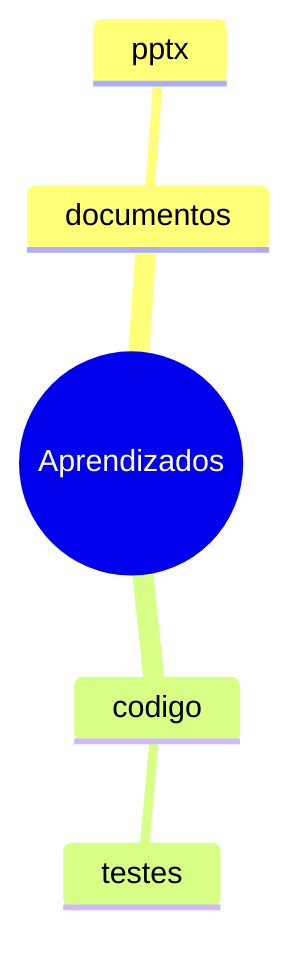

# Mapa de Aprendizado

Memória de longo prazo entre sessões e projetos. Toda tarefa **começa consultando** e **termina registrando**.

Aplique este fluxo em todas as tarefas, inclusive as pequenas — sem incomodar o usuário com o processo.

## Arquivos

```
E:\INTELIGENCIA_ARTIFICIAL\SKILL\_aprendizados\
├── MAPA.md           # índice: domínios -> lições (+ mindmap)
├── REGRAS.md         # top regras confirmadas — leitura rápida, máx. 20 linhas
├── PREFERENCIAS.md   # preferências estáveis do usuário
├── LOG.md            # diário append-only: 1 linha por tarefa
├── licoes\<dominio>\<slug>.md
└── _arquivo\         # lições frias ou superadas
```

Esta skill é mantida em `E:\INTELIGENCIA_ARTIFICIAL\SKILL\learning-map`. Para mudar o comportamento, edite lá e reinstale com `skill.install` — a memória em `_aprendizados` nunca é tocada por reinstalações.

Se a pasta não existir, crie-a e semeie `MAPA.md`, `REGRAS.md`, `PREFERENCIAS.md` e `LOG.md` a partir de `assets/` desta skill. Sem permissão de acesso, peça uma única vez; se negada, siga sem memória e avise em uma linha.

## Passo 1 — Consultar (antes de agir)

1. Leia `REGRAS.md` (curto) e `PREFERENCIAS.md`.
2. Leia `MAPA.md`, classifique a tarefa em um domínio (`documentos`, `codigo`, `pesquisa`, `dados`, `comunicacao`, `midia`, `automacao`, `outros`).
3. Abra no máximo 3 lições realmente relevantes.
4. Anote `Usos: +1` e a data em cada lição aplicada.
5. Não narre este passo, a menos que perguntem.

## Passo 2 — Observar (durante)

Fique atento a: retrabalho, o que funcionou de primeira, correções do usuário, ferramentas que falharam, suposições que se mostraram falsas.

## Passo 3 — Registrar (só no fim, nunca no meio da tarefa)

### 3a. Log — sempre

Acrescente uma linha ao fim de `LOG.md`, mesmo que não haja lição nova:

```
- 2026-10-28 · documentos · deck do cliente · parcial · fontes pequenas no projetor; subir para 18pt
```

Formato: `- data · domínio · tarefa curta · sucesso|parcial|falha · nota de 1 linha`

### 3b. Lição — só se for reutilizável

**Registre quando:** o padrão se repetiria em outra tarefa; o usuário corrigiu você; uma abordagem falhou de forma instrutiva.
**Não registre:** fatos efêmeros, detalhes de um único arquivo, obviedades, credenciais, dados privados ou conteúdo do usuário (descreva o método, nunca o conteúdo).

1. Procure lição existente (título, tags, busca no mapa).
2. Se existir: **atualize** — nova evidência, confiança, regra. Nunca duplique.
3. Se não existir: crie `licoes\<dominio>\<slug>.md` com o template abaixo.
4. Confiança: `hipótese` (1 vez) → `testada` (2) → `confirmada` (3+). Aplique `hipótese` com cautela e diga que é hipótese.
5. Se uma lição `confirmada` causar erro: rebaixe a confiança e anexe o contraexemplo — nunca apague histórico.

### 3c. Preferência do usuário

Tom, formato, ferramenta preferida, "nunca faça X" → vão para `PREFERENCIAS.md`, não para uma lição. Preferências são regras duras: obedeça sempre.

### 3d. Promoção para regras

Uma lição `confirmada`, genérica e de alto impacto sobe para `REGRAS.md` como uma linha `> `. Máximo de 20 linhas: ao passar, remova a menos usada.

### 3e. Arquivamento

Lição `hipótese` sem uso há 90 dias → mova para `_arquivo\` e remova do mapa. Lição superada por outra → `_arquivo\` com nota `substituída por <slug>`.

### 3f. Fechamento

Atualize `MAPA.md` (tabela do domínio + mindmap se a estrutura mudou). Encerre com no máximo uma linha: `Aprendizado registrado: <título>`. Se nada foi aprendido, não diga nada.

## Template de lição

```markdown
# <Título curto e acionável>

- Domínio: <dominio>
- Criado: AAAA-MM-DD · Atualizado: AAAA-MM-DD
- Confiança: hipótese | testada | confirmada
- Usos: 0 · Última aplicação: AAAA-MM-DD
- Tags: tag1, tag2

## Contexto
Quando este caso aparece.

## O que funcionou
- ...

## O que falhou / evitar
- ...

## Regra prática
> Uma frase aplicável sem precisar ler o resto.

## Como verificar
Como saber, objetivamente, que a regra funcionou nesta tarefa.

## Evidências
- AAAA-MM-DD · tarefa: o que aconteceu e qual foi o resultado.
```

## Formato do mapa (`MAPA.md`)

````markdown
# Mapa de Aprendizado

> Índice das lições reutilizáveis. Atualizado em AAAA-MM-DD.

## Visão geral



## documentos

| Lição | Confiança | Usos | Atualizado | Regra em 1 linha |
| --- | --- | --- | --- | --- |
| [Slides com python-pptx](licoes/documentos/slides-python-pptx.md) | hipótese | 1 | 2026-10-28 | Validar gerando PDF antes de entregar |
````

## Regras de qualidade

- **1 lição = 1 ideia.** Título acionável ("Gerar slides e validar renderizando"), não tema vago ("PowerPoint").
- Máximo de 120 linhas por lição; máximo de ~40 lições por domínio — ao passar, consolide as antigas.
- Português; termos técnicos e nomes de ferramentas no original.
- Toda lição precisa de **Regra prática**, **Como verificar** e ao menos uma **Evidência**.
- Nunca registre senhas, tokens, chaves, dados pessoais ou trechos privados.
- Se o usuário disser que algo está errado, prioridade máxima: revise as lições relacionadas antes de continuar.
