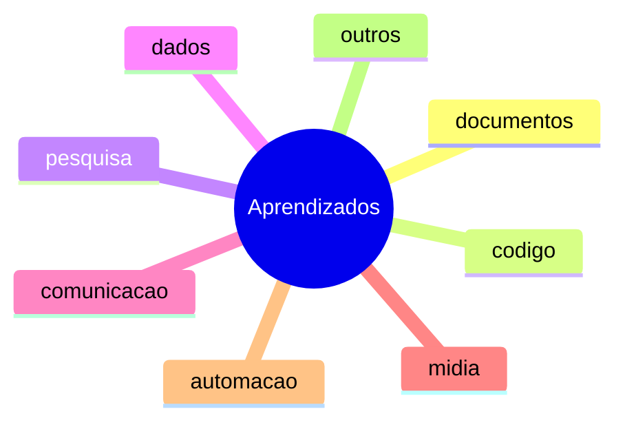

# Mapa de Aprendizado

> Índice das lições reutilizáveis aprendidas em sessões anteriores. Atualizado em 2026-10-28.

## Visão geral

## documentos

| Lição | Confiança | Usos | Atualizado | Regra em 1 linha |
| --- | --- | --- | --- | --- |

## codigo

| Lição | Confiança | Usos | Atualizado | Regra em 1 linha |
| --- | --- | --- | --- | --- |

## pesquisa

| Lição | Confiança | Usos | Atualizado | Regra em 1 linha |
| --- | --- | --- | --- | --- |

## dados

| Lição | Confiança | Usos | Atualizado | Regra em 1 linha |
| --- | --- | --- | --- | --- |

## comunicacao

| Lição | Confiança | Usos | Atualizado | Regra em 1 linha |
| --- | --- | --- | --- | --- |

## midia

| Lição | Confiança | Usos | Atualizado | Regra em 1 linha |
| --- | --- | --- | --- | --- |

## automacao

| Lição | Confiança | Usos | Atualizado | Regra em 1 linha |
| --- | --- | --- | --- | --- |

## outros

| Lição | Confiança | Usos | Atualizado | Regra em 1 linha |
| --- | --- | --- | --- | --- |
